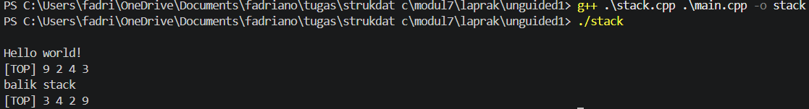
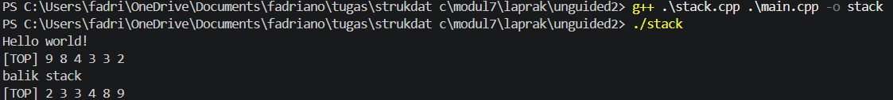
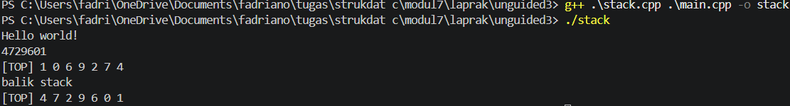

# <h1 align="center">Laporan Praktikum Modul 7 Struktur Data </h1>
<p align="center">Fadriano Bumindra Abiyyu - 109082500170</p>

## Dasar Teori
### A. Stack <br/>
Stack adalah struktur data linier yang bekerja dengan prinsip LIFO (Last In First Out), yaitu elemen yang terakhir masuk adalah elemen yang pertama keluar[1][3]. Akses pada stack hanya dilakukan di bagian paling atas yang disebut Top[3].
#### 1. Push
Push adalah operasi menambahkan elemen baru pada posisi teratas stack[1]..
#### 2. Pop
Pop adalah operasi menghapus elemen teratas dari stack dan mengembalikan nilainya[1].
### B. Representasi Stack <br/>
Stack dapat dibuat dengan du representasi.
#### 1. Representasi pointer
Stack disusun dari elemen yang saling terhubung lewat pointer next, sehingga ukurannya dapat berubah[3].
#### 2. Representasi tabel (Array)
Stack disimpan dalam array berindeks dengan jumlah elemen yang terbatas[1][3]. Data pada array dapat dikelompokkan dengan struct[2].
## Guided 

### stack.h

```C++
/* file : stack.h
   contoh ADT stack dengan representasi tabel */
#ifndef STACK_H_INCLUDED
#define STACK_H_INCLUDED

#include <iostream>
using namespace std;

struct infotype {
    char nim[20];
    char nama[20];
};
struct Stack {
    infotype info[10];
    int Top;
};

/* prototype */
/******** pengecekan apakah Stack kosong *********/
int isEmpty(Stack S);
/* mengembalikan nilai 0 jika stack kosong */

/******** pembuatan Stack ********/
void createStack(Stack &S);
/* I.S. sembarang
   F.S. terbentuk stack dengan Top=0 */

/******** penambahan elemen pada Stack ********/
void push(Stack &S, infotype X);
/* I.S. Stack mungkin kosong
   F.S. menambahkan elemen pada stack dengan nilai X, TOP=TOP+1 */

/******** penghapusan elemen pada Stack ********/
void pop(Stack &S, infotype &X);
/* I.S. stack tidak kosong
   F.S. nilai info pada indeks TOP disimpan pada X, kemudian TOP=TOP-1 */

/******** proses semua elemen Stack *********/
void viewStack(Stack S);
/* I.S. stack mungkin kosong
   F.S. jika stack tidak kosong menampilkan semua info yang ada pada stack
*/
#endif // STACK_H_INCLUDED
```
Kode tersebut berisi definisi struct infotype (nim dan nama berupa array char) dan struct Stack yang memakai array info berukuran 10 serta variabel Top. File ini juga memuat deklarasi isEmpty, createStack, push, pop, dan viewStack beserta komentar kondisi awal (I.S.) dan kondisi akhir (F.S.) setiap prosedur.

### stack.cpp

```C++
#include "stack.h"

int isEmpty(Stack S) {
    /* Top = 0 berarti kosong, sesuai komentar di stack.h dikembalikan 0 */
    if (S.Top == 0) {
        return 0;
    } else {
        return 1;
    }
}

void createStack(Stack &S) {
    S.Top = 0;
}

void push(Stack &S, infotype X) {
    if (S.Top < 10) {
        S.Top = S.Top + 1;
        S.info[S.Top - 1] = X;   /* Top 1..10 dipetakan ke indeks array 0..9 */
    } else {
        cout << "Stack penuh, data tidak bisa ditambahkan" << endl;
    }
}

void pop(Stack &S, infotype &X) {
    if (isEmpty(S) != 0) {
        X = S.info[S.Top - 1];
        S.Top = S.Top - 1;
    } else {
        cout << "Stack kosong, tidak ada data yang bisa diambil" << endl;
    }
}

void viewStack(Stack S) {
    if (isEmpty(S) == 0) {
        cout << "Stack kosong" << endl;
    } else {
        cout << "Isi stack (dari TOP):" << endl;
        for (int i = S.Top; i >= 1; i--) {
            cout << i << ". " << S.info[i - 1].nim << " - "
                 << S.info[i - 1].nama << endl;
        }
    }
}
```
Kode tersebut berisi implementasi atau logika pemrograman dari operasi stack. createStack mengisi Top dengan 0 sebagai tanda stack kosong, isEmpty mengembalikan 0 jika stack kosong, dan push serta pop menaikkan atau menurunkan Top sambil menyimpan atau mengambil data di array. Karena Top dimulai dari 1, indeks array yang dipakai adalah Top - 1.

### main.cpp 

```C++
#include <iostream>
#include <cstring>
#include "stack.h"
using namespace std;

int main() {
    Stack S;
    infotype data, hasil;

    createStack(S);
    cout << "Stack baru dibuat, Top = " << S.Top << endl;
    viewStack(S);

    cout << endl << "--- Push 3 data ---" << endl;
    strcpy(data.nim, "103112400001");
    strcpy(data.nama, "Andi");
    push(S, data);

    strcpy(data.nim, "103112400002");
    strcpy(data.nama, "Budi");
    push(S, data);

    strcpy(data.nim, "103112400003");
    strcpy(data.nama, "Citra");
    push(S, data);
    viewStack(S);

    cout << endl << "--- Pop 1 data ---" << endl;
    pop(S, hasil);
    cout << "Data yang diambil: " << hasil.nim << " - " << hasil.nama << endl;
    viewStack(S);

    cout << endl << "--- Pop sampai kosong ---" << endl;
    pop(S, hasil);
    pop(S, hasil);
    pop(S, hasil);
    viewStack(S);

    return 0;
}
```
Kode tersebut berisi program utama yang membuat stack, memasukkan tiga data mahasiswa dengan push, lalu mengambil satu data dengan pop. Setelah itu dilakukan pop berulang sampai stack kosong, dan viewStack dipanggil di setiap tahap untuk menampilkan isi stack.

## Unguided 

### 1. Buatlah ADT Stack menggunakan ARRAY di dalam file "stack.h", implementasinya pada file "stack.cpp", dan cobalah oada file "main.cpp".
### stack.h
```C++
#ifndef STACK_H
#define STACK_H

#include <iostream>
using namespace std;

typedef int infotype;

struct Stack {
    infotype info[20];
    int top;
};

void createStack(Stack &S);
void push(Stack &S, infotype x);
infotype pop(Stack &S);
void printInfo(Stack S);
void balikStack(Stack &S);

#endif
```
### stack.cpp
```C++
#include "stack.h"

void createStack(Stack &S) {
    S.top = -1;
}

void push(Stack &S, infotype x) {
    if (S.top < 19) {
        S.top++;
        S.info[S.top] = x;
    } else {
        cout << "Stack penuh" << endl;
    }
}

infotype pop(Stack &S) {
    infotype x = -1;
    if (S.top >= 0) {
        x = S.info[S.top];
        S.top--;
    } else {
        cout << "Stack kosong" << endl;
    }
    return x;
}

void printInfo(Stack S) {
    cout << "[TOP] ";
    for (int i = S.top; i >= 0; i--) {
        cout << S.info[i] << " ";
    }
    cout << endl;
}

void balikStack(Stack &S) {
    int kiri = 0;
    int kanan = S.top;
    while (kiri < kanan) {
        infotype temp = S.info[kiri];
        S.info[kiri] = S.info[kanan];
        S.info[kanan] = temp;
        kiri++;
        kanan--;
    }
}
```
### main.cpp
```C++
#include "stack.h"

int main() {
    cout << "Hello world!" << endl;
    Stack S;
    createStack(S);
    push(S, 3);
    push(S, 4);
    push(S, 8);
    pop(S);
    push(S, 2);
    push(S, 3);
    pop(S);
    push(S, 9);
    printInfo(S);
    cout << "balik stack" << endl;
    balikStack(S);
    printInfo(S);
    return 0;
}
```
### Output Unguided 1 :
Hello world!
[TOP] 9 2 4 3 
balik stack
[TOP] 3 4 2 9 

##### Output


Kode tersebut membuat ADT stack dengan array berukuran 20, dengan top bernilai -1 saat stack kosong. Prosedur push menambah elemen di top, pop mengambil elemen di top, dan balikStack membalik urutan isi array dengan menukar elemen dari kedua ujung. Prosedur printInfo menampilkan isi stack dari top.

### 2. Tambahkan prosedur pushAscending( in/out S : Stack, in x : integer)
### stack.h
```C++
#ifndef STACK_H
#define STACK_H

#include <iostream>
using namespace std;

typedef int infotype;

struct Stack {
    infotype info[20];
    int top;
};

void createStack(Stack &S);
void push(Stack &S, infotype x);
infotype pop(Stack &S);
void printInfo(Stack S);
void balikStack(Stack &S);
void pushAscending(Stack &S, infotype x);

#endif
```
### stack.cpp
```C++
#include "stack.h"

void createStack(Stack &S) {
    S.top = -1;
}

void push(Stack &S, infotype x) {
    if (S.top < 19) {
        S.top++;
        S.info[S.top] = x;
    } else {
        cout << "Stack penuh" << endl;
    }
}

infotype pop(Stack &S) {
    infotype x = -1;
    if (S.top >= 0) {
        x = S.info[S.top];
        S.top--;
    } else {
        cout << "Stack kosong" << endl;
    }
    return x;
}

void printInfo(Stack S) {
    cout << "[TOP] ";
    for (int i = S.top; i >= 0; i--) {
        cout << S.info[i] << " ";
    }
    cout << endl;
}

void balikStack(Stack &S) {
    int kiri = 0;
    int kanan = S.top;
    while (kiri < kanan) {
        infotype temp = S.info[kiri];
        S.info[kiri] = S.info[kanan];
        S.info[kanan] = temp;
        kiri++;
        kanan--;
    }
}

void pushAscending(Stack &S, infotype x) {
    if (S.top < 19) {
        int i = S.top;
        while (i >= 0 && S.info[i] > x) {
            S.info[i + 1] = S.info[i];
            i--;
        }
        S.info[i + 1] = x;
        S.top++;
    } else {
        cout << "Stack penuh" << endl;
    }
}
```
### main.cpp
```C++
#include "stack.h"

int main() {
    cout << "Hello world!" << endl;
    Stack S;
    createStack(S);
    pushAscending(S, 3);
    pushAscending(S, 4);
    pushAscending(S, 8);
    pushAscending(S, 2);
    pushAscending(S, 3);
    pushAscending(S, 9);
    printInfo(S);
    cout << "balik stack" << endl;
    balikStack(S);
    printInfo(S);
    return 0;
}
```
### Output Unguided 2 :
Hello world!
[TOP] 9 8 4 3 3 2 
balik stack
[TOP] 2 3 3 4 8 9 
##### Output


Kode tersebut menambahkan prosedur pushAscending yang menyisipkan data pada posisi yang sesuai dengan menggeser elemen yang lebih besar satu indeks ke atas. Dengan begitu isi stack selalu terurut, dengan nilai terkecil di dasar dan nilai terbesar di top.

### 3. Tambahkan prosedur getInputStream( in/out S : Stack ). Prosedur akan terus membaca dan menerima input user dan memasukkan setiap input ke dalam stack hingga user menekan tombol enter. Contoh: gunakan cin.get() untuk mendapatkan inputan user.
### stack.h
```C++
#include <iostream>
using namespace std;

const int PANJANG = 10;
int cariMinimum(int arr[], int n) {
    int min = arr[0];
    for (int i = 1; i < n; i++)
        if (arr[i] < min)
            min = arr[i];
    return min;
}
int cariMaksimum(int arr[], int n) {
    int max = arr[0];
    for (int i = 1; i < n; i++)
        if (arr[i] > max)
            max = arr[i];
    return max;
}
void hitungRataRata(int arr[], int n) {
    int total = 0;
    for (int i = 0; i < n; i++)
        total += arr[i];
    float rata = (float) total / n;
    cout << "Nilai rata-rata: " << rata << endl;
}

int main() {
    int arrA[PANJANG] = {11, 8, 5, 7, 12, 26, 3, 54, 33, 55};
    int pilihan;

    do {
        cout << "\n--- Menu Program Array ---" << endl;
        cout << "1. Tampilkan isi array" << endl;
        cout << "2. Cari nilai maksimum" << endl;
        cout << "3. Cari nilai minimum" << endl;
        cout << "4. Hitung nilai rata - rata" << endl;
        cout << "Pilih menu: ";
        cin >> pilihan;

        switch (pilihan) {
            case 1:
                cout << "Isi array: ";
                for (int i = 0; i < PANJANG; i++)
                    cout << arrA[i] << " ";
                cout << endl;
                break;
            case 2:
                cout << "Nilai maksimum: " << cariMaksimum(arrA, PANJANG) << endl;
                break;
            case 3:
                cout << "Nilai minimum: " << cariMinimum(arrA, PANJANG) << endl;
                break;
            case 4:
                hitungRataRata(arrA, PANJANG);
                break;
            default:
                cout << "Pilihan tidak valid! Program selesai." << endl;
        }
    } while (pilihan >= 1 && pilihan <= 4);

    return 0;
}
```
### Output Unguided 3 :
Hello world!
4729601
[TOP] 1 0 6 9 2 7 4 
balik stack
[TOP] 4 7 2 9 6 0 1 
##### Output


Kode tersebut menambahkan prosedur getInputStream yang membaca input dengan cin.get() satu karakter demi satu karakter sampai user menekan enter. Setiap karakter angka diubah menjadi bilangan lalu dimasukkan ke dalam stack dengan push.

## Kesimpulan
Stack bekerja dengan prinsip LIFO sehingga elemen yang terakhir dimasukkan adalah elemen yang pertama diambil. Operasi push dan pop hanya dilakukan di Top, dan pada representasi array jumlah elemen yang dapat ditampung terbatas. Pada praktikum ini, stack dengan array dipakai untuk menambah elemen dengan push, mengambil elemen dengan pop, menyisipkan data secara terurut dengan pushAscending, membalik isi stack dengan balikStack, serta membaca input dari keyboard dengan getInputStream.

## Referensi
[1] Setiyawan, R. D., Hermawan, D., Abdillah, A. F., Mujayanah, A., & Vindua, R. (2024). "Penggunaan Struktur Data Stack dalam Pemrograman C++ dengan Pendekatan Array dan Linked List". JUTECH: Journal Education and Technology, Vol. 5, No. 2, Desember 2024, hlm. 484-498. DOI: https://doi.org/10.31932/jutech.v5i2.4263. Diakses pada 16 November 2026 melalui https://jurnal.stkippersada.ac.id/jurnal/index.php/jutech/article/view/4263. <br> 
[2] Maylova, R. A., Noviana, N., Abdussalam, A., Pramudya, E. R., & Muslih, M. (2025). "Sistem Manajemen Data Mahasiswa Berbasis Pemrograman C++ untuk Efisiensi Administrasi Akademik". Jurnal Aplikasi Teknologi dan Komputasi, Vol. 1, No. 3, hlm. 24-33. Diakses pada 16 November 2026 melalui https://journals.arces.org/jatekom/article/view/83. <br> 
[3] Fakultas Informatika, Telkom University. (n.d.). "Modul 7: Stack". Modul Praktikum Struktur Data. Informatics Lab.